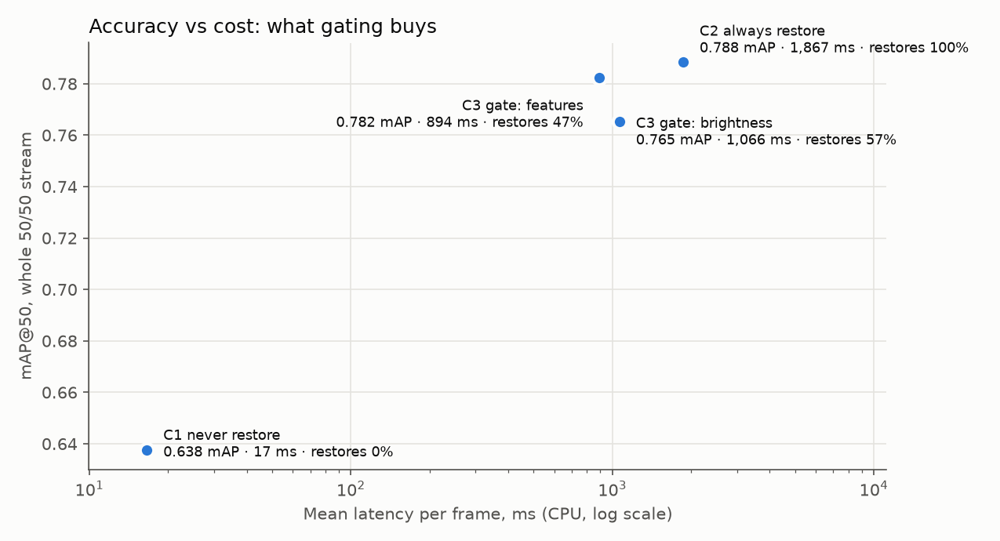
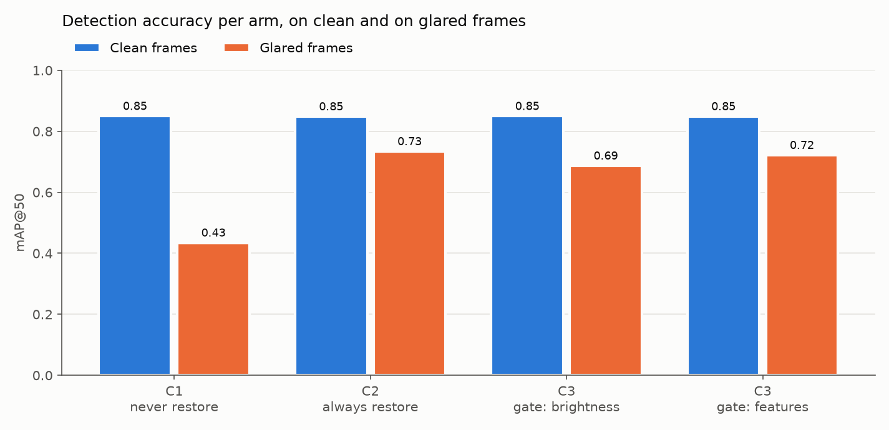
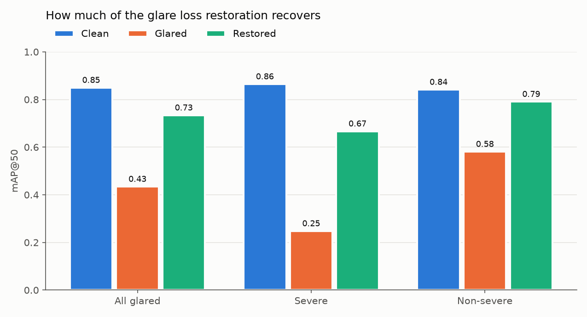

# Glare-gated detection: demo results

> **DEMO, not final.** These numbers come from v2 synthetic data that **failed its
> shortcut test** (darkest-pixel p1 AUC 0.998; min AUC 0.999; noise-level AUC 0.724; artifact-only classifier 83.7%). The gate rows are the most affected: a gate can
> use those artifacts. Final numbers wait for a synthesis that passes.

## Setup
- **Data:** KITTI val, 1,491 frames, each shown clean **and** glared
  (2,982 images, exactly 50/50). Glare: v2 camera-model synthesis,
  four types, continuous severity. 5 frames used to tune the restorer are excluded.
- **Detector:** YOLOv8n trained on clean KITTI train only (`models/yolo_c1_train.pt`, 50 epochs).
- **Restorer:** pretrained Flare7K++ Uformer, whole-frame mode (`src/restore_seamless.py`,
  built on Vihaan's handover). **1,850 ms/frame on CPU.**
- **Gates (C3),** fit on v2 *train* only: an upper-third brightness threshold, and a
  logistic regression on Harshitha's 9 gate features (standing in for her v2 gate).

## Headline
| Arm | mAP@50 stream | clean frames | glared frames | glared, severe | Restores | Latency ms/frame (CPU) |
|---|---|---|---|---|---|---|
| C1 · never restore | 0.638 | 0.850 | 0.434 | 0.248 | 0.0% | 17 |
| C2 · always restore | 0.788 | 0.848 | 0.734 | 0.667 | 100.0% | 1,867 |
| C3 · gate: brightness | 0.765 | 0.850 | 0.687 | 0.635 | 56.7% | 1,066 |
| C3 · gate: features | 0.782 | 0.849 | 0.722 | 0.663 | 47.3% | 894 |

- **Glare costs the detector 0.415 mAP@50**
  (0.850 → 0.434); on severe frames
  0.865 → 0.248.
- **Gating:** the best C3 (C3 · gate: features) runs at 894 ms/frame against C2's
  1,867 ms/frame (2.1× cheaper), restoring 47%
  of frames.

## Restoration recovers most of the glare loss
| Glared frames | n | Clean | Glared | Restored | Share of loss recovered |
|---|---|---|---|---|---|
| All | 1491 | 0.850 | 0.434 | 0.734 | 72% |
| Severe | 640 | 0.865 | 0.248 | 0.667 | 68% |
| Non-severe | 851 | 0.841 | 0.581 | 0.791 | 81% |

Restoring a frame **without** glare is nearly free in accuracy: on a 200-frame subset,
clean-frame mAP@50 went 0.874 →
0.871
(-0.003). So gating saves **time**, not accuracy.

## Latency breakdown (mean ms per frame, CPU, warm-up excluded)
| Arm | Gate | Detection | Restoration × trigger rate | Total |
|---|---|---|---|---|
| C1 · never restore | 0.00 | 16.6 | 0 | **17** |
| C2 · always restore | 0.00 | 16.6 | 1,850 | **1,867** |
| C3 · gate: brightness | 0.12 | 16.6 | 1,049 | **1,066** |
| C3 · gate: features | 1.14 | 16.6 | 876 | **894** |

Restoration is ~111× the cost of detection,
which is what makes skipping it worthwhile.

## Gate quality (val, gate protocol: glared veiling_wash frames with s < 0.1752 not scored)
| Gate | Precision | Recall | F1 | Accuracy | Trigger rate |
|---|---|---|---|---|---|
| C3 · gate: brightness | 0.616 | 0.717 | 0.663 | 0.643 | 56.7% |
| C3 · gate: features | 0.916 | 0.882 | 0.899 | 0.903 | 47.3% |

The features gate is likely inflated by the synthesis artifacts. After restoration the same
features separate clean from glared far less well: accuracy 89.5%
on originals vs 61.3% clean-vs-restored (200-frame subset).

## Figures in this folder
| File | Shows |
|---|---|
| `01_pipeline_walkthrough_004980.png` | One frame through the pipeline: clean → glared (with both gate decisions) → restored, with detections |
| `02_glare_types_glared_vs_restored.png` | A typical severe frame of each glare type, before and after restoration |
| `03_severity_ramp_*.png` | Each glare type at lowest, median and highest severity |
| `04_gate_decisions.png` | The features gate: a correct fire, a correct skip, a false alarm and a miss |
| `05_restoring_a_clean_frame.png` | The cost side: restoration applied to a frame with no glare |
| `06_failure_case.png` | Where restoration cannot help (blown-out glare) |
| `07–09_chart_*.png` | The charts above |

**How frames were chosen (no cherry-picking):** per glare type, the severe frame with the
*median* detection gain from restoration; the walkthrough is the median over all types;
the failure case is the lowest F1 after restoration; gate examples are the median gate
score within each outcome. Over the 640 severe frames, the median per-frame F1
gain from restoration was +0.274.
Box colours: green = correct detection, red = false detection, yellow = missed object.

## Caveats
1. **Synthetic glare that failed its shortcut test.** Restoration may suit this additive,
   smooth glare better than real glare; confirm on real glare (e.g. BDD100K) before quoting.
2. **The C3 gates are stand-ins,** fit here on v2 train; Harshitha's v2 gate is not trained yet.
3. **Flare7K++ is a nighttime lens-flare model** applied to daytime sun glare.
4. KITTI's train/val split shares drives, so absolute mAP is slightly optimistic; the
   comparisons between arms use identical frames and are unaffected.
